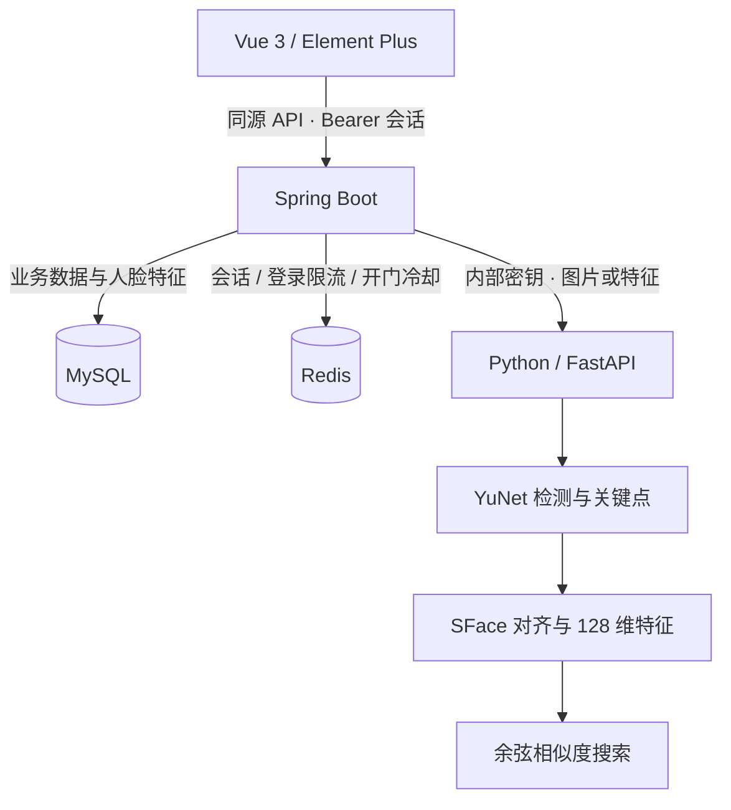

# 架构与数据库

## 调用关系

前端不直接调用 Python。身份识别由 Python 完成，人员、权限、通行决定由 Java 管理。Python 无 MySQL 连接，也不缓存人员库；每次识别由 Java 提供当前已录入特征，避免删除或禁用后仍使用旧缓存。

## 录入与识别

录入：检查图片大小与格式 → YuNet 检测唯一人脸 → 五点对齐裁剪 → SFace 提取 128 维向量 → L2 归一化 → 与其他已录入人员比对以防重复 → JSON 特征写入 MySQL。

识别：重复上述图片提取步骤 → 对已录入特征求余弦相似度 → 阈值与第一、第二名差值校验 → 查人员启用状态 → 查门禁状态与授权有效期 → Redis `SET NX` 获取五秒冷却标记 → 写通行记录 → 页面显示模拟开门。

停用的门禁在推理前直接拒绝。不存在有效身份、Python 故障或 Redis 故障时，系统不会返回开门成功。权限和人员状态不放入长期缓存。

## 数据表

| 表 | 用途 | 关键约束 |
| --- | --- | --- |
| `admin_user` | 管理员与 BCrypt 密码哈希 | 用户名唯一 |
| `person` | 编号、姓名、部门、状态、人脸特征 | 人员编号唯一 |
| `door` | 门禁名称、位置、启用状态 | 门禁名称唯一 |
| `access_grant` | 人员与门禁的起止权限 | 人员 + 门禁唯一；外键级联清理 |
| `access_log` | 通行判断、姓名快照、相似度、原因 | 删除人员后保留姓名快照，人员外键置空 |

建表脚本在 `backend/src/main/resources/schema.sql`。这里使用参数化 JDBC 便于讲解 SQL、关联和事务边界。照片不保存；`person.feature` 是归一化特征数组，不是照片路径。

当前建表脚本用于新环境初始化，不是数据库迁移框架。后续若改表结构，应增加明确的迁移脚本，不能依靠 `CREATE TABLE IF NOT EXISTS` 修改已有表。

## Redis 键

| 键 | 值 | 过期 |
| --- | --- | --- |
| `session:{token}` | 管理员用户名 | 8 小时，固定有效期 |
| `login-attempt:{ip}` | 登录尝试数 | 首次尝试起 15 分钟，最多 30 次 |
| `door-cooldown:{personId}:{doorId}` | `1` | 5 秒，`SET NX` 原子判重 |

登录尝试限制按后端看到的客户端 IP 计算。容器代理下当前作为本地演示的整体限流，未信任任意客户端提供的 `X-Forwarded-For`。如需公网部署，应配置可信代理和独立网络策略。

数据库日志与 Redis 冷却标记不做分布式事务：若日志写入失败，请求不会报告成功；短时间内可能仍保留冷却标记，五秒后自动释放。录入的重复检测适用于本版单实例管理场景；多实例并发录入需增加全局锁或独立特征管理服务。

## 时间与门锁

Java 使用 `Asia/Shanghai` 生成业务时间；授权接口接收不带偏移量的本地时间字符串，也按该时区解释。数据库 JDBC 时区、容器时区和前端标签保持一致。授权在起止时刻均包含当前时刻。

`doorOpen=true` 表示一次通过授权的模拟通行指令，不表示真实物理门锁状态。Vue 在本页面显示五秒开门动画，Redis 同时抑制五秒内重复放行。刷新页面后模拟状态恢复为关闭，不维护物理设备状态。

## 算法范围

YuNet 与 SFace 使用官方预训练权重。未训练自定义神经网络，贡献是模型调用、输入约束、特征管理、相似度搜索与门禁业务集成。余弦分数取值范围为 [-1, 1]，并非概率或准确率。默认阈值不构成特定数据集的准确率承诺。

Python 使用一个 worker，OpenCV 可变推理对象通过互斥锁保护。更换权重、特征维度或归一化方法后，旧特征必须清除并重新录入。
